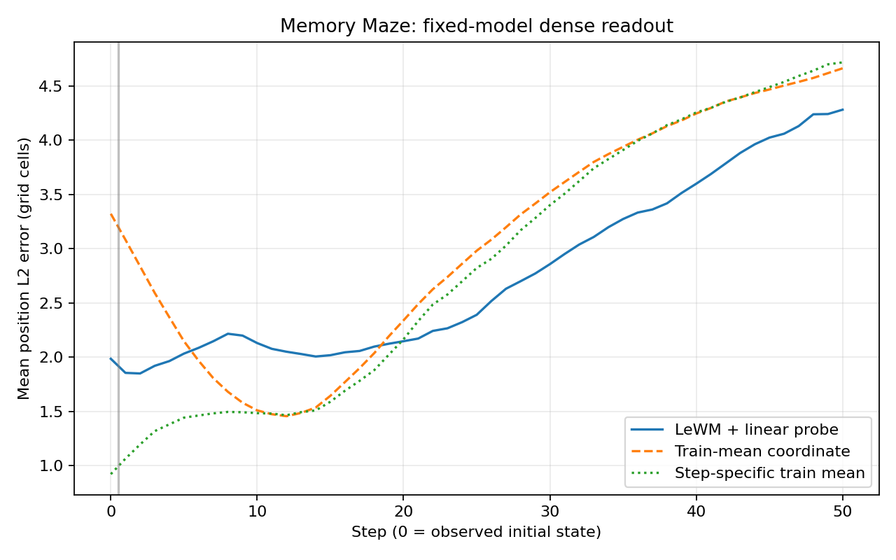
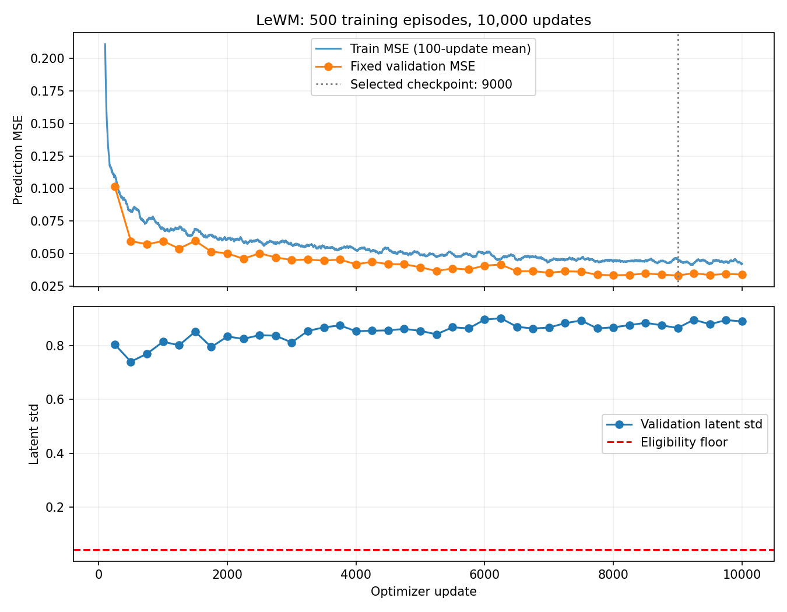

# Memory Maze 500개 Baseline 결과

완료 확인: 2026-11-21. 학과 클라우드 RTX 4000 Ada에서 수행. 코드 실행 성공과 기억 성능 입증을 구분한다.

## 확보·실행

| 항목 | 실제 결과 |
|---|---|
| 원본 | 공식 9×9 NPZ 1,200개, 4,190,406,346 bytes. CRC·형식·SHA 검사 통과 |
| 분할 | LeWM train/val 500/100, Probe 후보 train/val/test 300/100/200. 기존 160개 역할 유지, test eval 40~239 |
| 유효 구간 | 208/72/156. 후보 582개 중 승인 436·거부 146, 자동 후보 미충족 18. 초기 화면 검수이며 미래 가시성은 휴리스틱 |
| 학습 | 공개 Cube 고정 revision → 6-action encoder 초기화 → 공동 fine-tuning. seed 42·batch 16·10,000 update·160,000 window 추출 |
| 시간·메모리 | 학습 Job 2:19:58, runner 8341.10초. Peak allocated 2.655 GiB |
| 선택 모델 | update 9000, model-val MSE 0.03302500. 고정 100 window·분산 gate 적용 |
| 갱신 | Encoder 198·Predictor 81 tensor 변경 |
| Readout | 0=초기 마지막 관측, 1~50=미래 예측. 436/436 rollout 성공·실패 0 |
| Probe | 192→2 ridge, λ=0.001. Train/val/test 10,608/3,672/7,956쌍. λ는 Probe-val로만 선택 |
| 재로드 | best→inference 0~50 출력 최대 차이 0.0, Probe 재로드 차이 0.0. 로컬 복사 SHA 일치 |

## 최종 test

L2는 원본 ego-relative 평면 좌표의 거리이며 낮을수록 좋다. 동일 episode의 여러 step은 독립 episode로 세지 않는다.

| Step | 모델+공통 Probe | 전체 train 평균 좌표 | 해당 step의 train 평균 좌표 |
|---:|---:|---:|---:|
| 0 | 1.9865 | 3.3229 | 0.9232 |
| 1 | 1.8565 | 3.0833 | 1.0659 |
| 5 | 2.0344 | 2.1477 | 1.4440 |
| 10 | 2.1314 | 1.5109 | 1.4855 |
| 20 | 2.1484 | 2.3405 | 2.1662 |
| 30 | 2.8586 | 3.5212 | 3.4022 |
| 40 | 3.5999 | 4.2469 | 4.2570 |
| 50 | 4.2822 | 4.6635 | 4.7180 |

50-step 오차는 전체 평균 좌표 기준보다 8.18% 낮다. 초기 0~10에서는 step별 평균 기준보다 나쁘다. 모든 시점에서 우수하거나 공 기억을 인과적으로 보존했다고 주장하지 않는다.

## 관측 진단과 50 이후 범위

- 초기 관측만으로 따로 학습한 진단 Probe: test L2 **0.7937**, 해당 초기 좌표 평균 기준 **0.9232**, λ=0.01. 초기 표현에서 유용한 위치 정보가 읽힌다.
- 0~50을 함께 학습한 공통 Probe의 0-step L2는 1.9865로 초기 전용 진단보다 나쁘다. 공통 readout의 분포 혼합·적합 오차와 예측 중 정보 손실을 구분해야 한다.
- Probe-val 72 episode의 50−0-step L2 증가량 1.9721, paired bootstrap 95% 구간 [1.4369, 2.4855]. 하락이 검출돼 이번에는 50 이후를 늘리지 않았다.
- 단일 seed·episode 분리 조건이다. model-train/test 사이 공유 maze_layout은 4개다. 맵 배치 완전 독립·정밀 미래 가시성 mask·장기 기억 인과 검증은 완료한 항목이 아니다. 과거 100개 실험과 test·초기화·예산이 달라 직접 성능 개선률을 비교하지 않는다.

## Probe 자료 수 진단

| Train episode | 선택 λ | Validation 평균 L2 |
|---:|---:|---:|
| 50 | 0.1 | 2.9545 |
| 100 | 0.01 | 2.9370 |
| 200 | 0.001 | 2.8661 |
| 208 | 0.001 | 2.8715 |

고정 순서의 nested subset 진단이다. 최종 Probe는 미리 정한 전체 승인 train 208개로 학습했으며 test를 보고 표본 수·λ를 바꾸지 않았다.

## 재현·모델 사용

- [실험 계획](BASELINE_500_PLAN.md) · [2,000개 동일 조건 비교](BASELINE_V2_HANDOFF.md) · [모델 로딩·개선 접점](BASELINE_MODEL_USAGE.md)
- 모델과 대응 Probe: [baseline500-v2 배포 묶음](https://github.com/chest-press-man/memorymaze-lewm/releases/tag/baseline500-v2). 데이터 NPZ는 포함하지 않으며 공식 acquire 명령으로 확보한다.
- Inference SHA-256: `55ccdf3d4d4530a3eca1eea4df2a98bd001e3824c0cc37d5154a0a735b0ef907`
- Probe SHA-256: `a2139e31ca1c0b8e2880a463992de3ddfb0d9e4808f8444ae5dcd4ac7c8df637`
- 학습 core 실행 commit: `cc6d26d`. 재현·검사·배포 자료는 해당 core를 포함하는 baseline500-v2 tag에 묶는다.
- GitHub 반영은 별도 브랜치와 PR을 사용하며 main 직접 push·자동 병합은 수행하지 않는다.
